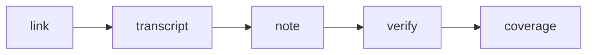

# transcript-first-video

[English](#transcript-first-video) · [中文](#中文)

[](https://github.com/HappyDrunk/transcript-first-video/actions/workflows/gate.yml)
[](LICENSE)
[](https://github.com/HappyDrunk/transcript-first-video/tags)

YouTube and X/Twitter video only, read from the transcript. The scripts fetch and check. You write the note.

The note waits until the spoken words are written down and pass a quality check. A title, a blurb, or the post beside the link is not a watch. The gate reads the transcript text. It does not listen to the audio.

## Quickstart

On install, ask for a language once, before any fetch. Save one line in `language.txt` beside the installed `SKILL.md`: `中文`, `英文`, or `中英文对照`. If that folder is not writable, keep the same line in the host project. If the file is missing or not one of those three, ask. Do not assume `中英文对照`. Do not commit `language.txt`.

```text
Install this skill: https://github.com/HappyDrunk/transcript-first-video
```

If the agent cannot install from a link, clone the folder and leave the name as it is:

```bash
git clone https://github.com/HappyDrunk/transcript-first-video.git ~/.agents/skills/transcript-first-video
```

Fetch one captioned URL. This writes a transcript and a blank scaffold. You write the finished note.

```bash
pip install -r requirements.txt
python3 scripts/youtube_host.py "https://www.youtube.com/watch?v=jNQXAC9IVRw" --out artifacts
```

That URL is "Me at the zoo" (`jNQXAC9IVRw`): short, public, and captioned. `ASR_BACKEND` stays off until you set it. No captions means the job stops unfinished. An X video uses the same gate: `python3 scripts/x_host.py "<status url>" --out artifacts`.

In chat, after install:

```text
Use transcript-first-video on this video, then write the note: <url>
```



## Contents

- [Note](#note)
- [Read-feel knobs](#read-feel-knobs)
- [Checks](#checks)
- [Development](#development)
- [Further reading](#further-reading)
- [License](#license)
- [中文](#中文)

## Note

This is what a finished note looks like.

```markdown
## 先记住一句话

## 问题与做法

## 完整怎么做

## 翻车或别用

## 今天立刻动手一步
```

Chinese delivery defaults to **小白能懂** — plain words for why, what, and the benefit; titles and the body stay free of piled jargon; a Latin proper noun from the talk may stay.

A filled example: [references/note-examples.md](references/note-examples.md).

## Read-feel knobs

The opening heading, the four sections, R01–R17, and Coverage C stay fixed. These knobs change read-feel only. They are not an install wizard. Set one only when someone asks. Changing a knob leaves R01–R17 and Coverage C in force. Delivery wording stays in the delivered body and does not rewrite `note.md`.

| Knob | What it changes |
| :--- | :--- |
| 语气 | How formal the sentences sound |
| 密度 | How tight or open the paragraphs are |
| 比喻 | A metaphor only when the quote already supports it |
| 类比 | An analogy only when the quote already supports it |
| 专名 | A Latin proper noun stays as the quote has it, unless you are told to gloss it |

## Checks

```bash
python3 scripts/verify_note.py --job artifacts/youtube_<id>
python3 scripts/coverage_check.py --job artifacts/youtube_<id>
```

`verify_note.py` is R01–R17. `coverage_check.py` runs after it, before the note is finished and before delivery. On a video longer than 5 minutes it checks the chunk inventory, quotes in at least three quartile stretches, and inventory coverage. The thresholds are in [scripts/README.md](scripts/README.md). At or under 5 minutes the command still runs. `--delivery` checks the Feishu or chat body. What each rule refuses: [references/rules.md](references/rules.md).

## Development

Offline, from a clone of this repo:

```bash
bash scripts/smoke.sh
```

`bash scripts/smoke.sh --live` also tries the short captioned URL above. It does not turn ASR on. Changes to this repo: [CONTRIBUTING.md](CONTRIBUTING.md).

## Further reading

- [SKILL.md](SKILL.md) — the rules the agent loads. If this page and that file disagree, follow the file.
- [scripts/README.md](scripts/README.md) — hosts, Coverage C, and environment-variable names.
- [references/rules.md](references/rules.md) — what R01–R17 refuse.
- [references/pitfalls.md](references/pitfalls.md) — a note that looks finished and is not.
- [evals/results/gate-evidence.md](evals/results/gate-evidence.md) — the fixture table CI scores. Not a grade of the summary.
- [evals/results/live/](evals/results/live/) — public-URL receipts. The old template notes were withdrawn.
- [evals/results/spotcheck.md](evals/results/spotcheck.md) — a human reading. CI does not score it.
- [evals/results/hall_j_retest_receipt.md](evals/results/hall_j_retest_receipt.md) — the in-distribution receipt for the 1.0.0 measure. Not a held-out result.
- [CHANGELOG.md](CHANGELOG.md)

## License

[MIT](LICENSE). Copyright (c) 2026 HappyDrunk.

## 中文

只抓 YouTube 和 Twitter/X 的视频。脚本负责抓取和核对。笔记由你来写。

笔记要等嘴里的话落成文字，并且通过质量检查。标题、简介、链接旁边的帖子，都不算看过。门槛读的是文稿，不听音频。

### 安装，然后跑一条

安装时先问一次语言，再抓视频。在装好的 `SKILL.md` 旁边，把一行写进 `language.txt`：`中文`、`英文`，或 `中英文对照`。那个目录不能写时，把同一行留在你自己的项目里。文件没有，或不是这三样，就问。不要默认中英文对照。不要提交 `language.txt`。

```text
帮我安装这个skill：https://github.com/HappyDrunk/transcript-first-video
```

不能从链接安装时，自己克隆，文件夹名留着：

```bash
git clone https://github.com/HappyDrunk/transcript-first-video.git ~/.agents/skills/transcript-first-video
```

一条有字幕的短视频。命令写下文稿和空白脚手架。写完的笔记由你来写。

```bash
pip install -r requirements.txt
python3 scripts/youtube_host.py "https://www.youtube.com/watch?v=jNQXAC9IVRw" --out artifacts
```

这是 "Me at the zoo"（`jNQXAC9IVRw`），短，公开，有字幕。`ASR_BACKEND` 不设置就是关着。没有字幕，任务停在没看完。X 视频走同一道门槛：`python3 scripts/x_host.py "<状态链接>" --out artifacts`。

装好之后，在对话里：

```text
用 transcript-first-video，把这个视频看完再写笔记：<url>
```

```text
链接 → 文稿 → 笔记 → verify → coverage
```

### 笔记

写完的笔记长这样。

```markdown
## 先记住一句话

## 问题与做法

## 完整怎么做

## 翻车或别用

## 今天立刻动手一步
```

中文交付默认是 **小白能懂**：用白话写为什么、是什么、好处；标题和正文不堆术语；口播里的拉丁专名可以留着。

写完的例子：[references/note-examples.md](references/note-examples.md)。

### 读感旋钮

开头标题、四节、R01–R17、Coverage C 保持不动。下面只改读感。安装时不问。有人开口要改，才动。改旋钮之后，R01–R17 和 Coverage C 仍然有效。交付时的措辞留在交付正文里，不回写 `note.md`。

| 旋钮 | 改什么 |
| :--- | :--- |
| 语气 | 句子正式还是口语 |
| 密度 | 段落紧还是松 |
| 比喻 | 只用引文已经撑得住的比喻 |
| 类比 | 只用引文已经撑得住的类比 |
| 专名 | 拉丁专名按引文保留，除非明确要求改写成解释 |

### 核对

```bash
python3 scripts/verify_note.py --job artifacts/youtube_<id>
python3 scripts/coverage_check.py --job artifacts/youtube_<id>
```

`verify_note.py` 是 R01–R17。`coverage_check.py` 在它之后跑，标完成之前和交付之前都要跑。超过五分钟，它核对分块清单、引文至少盖住三个时间四分位，以及清单覆盖。具体门槛在 [scripts/README.md](scripts/README.md)。不超过五分钟，这道命令仍然要跑。`--delivery` 核对飞书或聊天正文。每条规则拒绝什么：[references/rules.md](references/rules.md)。

离线，在本仓库的克隆里：

```bash
bash scripts/smoke.sh
```

`bash scripts/smoke.sh --live` 会再试上面那条短字幕视频，不会打开 ASR。怎么改这个仓库：[CONTRIBUTING.md](CONTRIBUTING.md)。

### 延伸阅读

- [SKILL.md](SKILL.md) — Agent 加载的规矩。这一页和那个文件不一致时，以那个文件为准。
- [scripts/README.md](scripts/README.md) — 两个主机、Coverage C、环境变量的名字。
- [references/rules.md](references/rules.md) — R01–R17 各自拒绝什么。
- [references/pitfalls.md](references/pitfalls.md) — 笔记看着写完了，其实没有。
- [evals/results/gate-evidence.md](evals/results/gate-evidence.md) — CI 打分的夹具表。不是给摘要打分。
- [evals/results/live/](evals/results/live/) — 公开网址的回执。旧的模板笔记已撤回。
- [evals/results/spotcheck.md](evals/results/spotcheck.md) — 人读的记录。CI 不打分。
- [evals/results/hall_j_retest_receipt.md](evals/results/hall_j_retest_receipt.md) — 1.0.0 那次的分布内回执。不是留出集上的结果。
- [CHANGELOG.md](CHANGELOG.md)

### 许可

[MIT](LICENSE)。Copyright (c) 2026 HappyDrunk。
