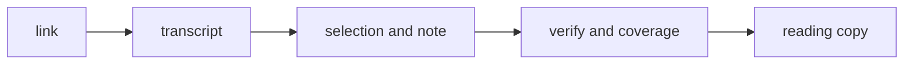

# transcript-first-video

v1.2.0（Release 将在合入 main 后发布，替代旧 v0.2.0 Latest）

[English](#transcript-first-video) · [中文](#中文)

[](https://github.com/HappyDrunk/transcript-first-video/actions/workflows/gate.yml)
[](LICENSE)
[](https://github.com/HappyDrunk/transcript-first-video/tags)

YouTube is the active supported platform, read from the transcript. X/Twitter video support is frozen: maintenance is paused, and its historical CLI remains documented in `scripts/README.md`. The scripts fetch and check. You write the note.

The note waits until the spoken words are written down and pass a quality check. A title, a blurb, or the post beside the link is not a watch. The gate reads the transcript text. It does not listen to the audio.

## 实跑节选（v1.1.0）

### 实跑成品节选（v1.1.0 真实生成 · The Plain Bagel）

> **Is the S&P 500 Too Concentrated?** · The Plain Bagel · 2024-03-01 · [原视频](https://www.youtube.com/watch?v=h6nHqwkZOZg)
>
> **先记住一句话**：买标普500并不等于完全被动、毫无偏向。你其实是在押美国大公司、尤其是少数科技巨头；集中度确实升高了，但讲者认为还没到危急程度，也可以改用更宽或等权的指数来调整这笔赌注。
>
> **画面图表实读节选（03:51–09:01）**：七巨头都在市值最大的前十名里，合计占标普500市值的28.6%，但按预期只贡献2024年指数盈利的19.5%。……前十大持仓只占指数成分公司数量的2%，却大约贡献了整个指数市值的三分之一，基本上是70年代以来最高的水平。截至2024年1月31日，前十大合计占31.26%；其中微软占7.26%，苹果占6.63%。……信息技术和通信这两个行业合计占38.4%，而全指数一共有11个行业类别。

## 什么时候用本 Skill

| 用本 Skill | 直接问裸模型 |
| --- | --- |
| 要让笔记里的说法逐句有出处 | 只要一句话印象 |
| 要从长视频里提取方法、步骤和条件 | 视频很短，只想知道大意 |
| 要避免让模型根据标题猜内容 | 能接受回答未经核实 |

## 30 秒安装

把整个仓库放到下面的目录，再进入仓库根目录运行安装命令。

| 平台 | Skill 放置目录 | 触发话术 |
| --- | --- | --- |
| Claude Code | `~/.claude/skills/transcript-first-video` | `/transcript-first-video <YouTube URL>` |
| Codex | `~/.agents/skills/transcript-first-video` | `用 $transcript-first-video 通读这个视频：<YouTube URL>` |
| Antigravity | `<工作区>/.agents/skills/transcript-first-video` 或 `~/.gemini/config/skills/transcript-first-video`。独立 IDE 也兼容 `~/.gemini/antigravity/skills/transcript-first-video` | `用 transcript-first-video 通读这个视频：<YouTube URL>` |
| Cursor | 把仓库放在项目内，在 `.cursor/rules/` 的 `.mdc` 规则里引用 `SKILL.md` | `按规则里的 transcript-first-video 流程通读：<YouTube URL>` |

自定义目录以各平台官方文档为准。[Claude Code](https://code.claude.com/docs/en/skills) · [Codex](https://learn.chatgpt.com/docs/build-skills#where-codex-loads-local-skills) · [Antigravity](https://antigravity.google/docs/skills) · [Cursor](https://cursor.com/docs/rules)

```sh
python scripts/setup.py
python scripts/install_check.py --doctor
```

## 实测耗时

| 模式 | 视频时长 | 安装 | 抓取 | 成稿 | 总计 | 机器/日期 |
| --- | --- | --- | --- | --- | --- | --- |
| 待 P1-6 实测 | 待 P1-6 实测 | 待 P1-6 实测 | 待 P1-6 实测 | 待 P1-6 实测 | 待 P1-6 实测 | 待 P1-6 实测 |

## Quickstart

For YouTube jobs, use `scripts/youtube_host.py --show-pref` to inspect saved preferences. Pass `--language` (中文, 英文, or 中英文对照) and `--reading-level` (plain or concise) to set this run’s choices. Add `--save-pref` with both choices to save them in the user config file `prefs.json` outside the repo.

```text
Install this skill: https://github.com/HappyDrunk/transcript-first-video
```

Install the whole repository directory. Do not copy only `SKILL.md` or a subset of `scripts/`; the skill depends on the scripts and reference files beside it. If the agent cannot install from a link, clone the repository and leave the folder name as it is:

```bash
git clone https://github.com/HappyDrunk/transcript-first-video.git ~/.agents/skills/transcript-first-video
python3 ~/.agents/skills/transcript-first-video/scripts/install_check.py
```

The check prints the installed commit (or the `VERSION` for a source copy) and fails with a list of missing files when the installation is incomplete.

From the installed skill folder, use pip with `--group` support to install dependencies and fetch a captioned URL. If system Python reports `externally-managed-environment` (PEP 668), create and activate a `venv` (`python3 -m venv .venv && source .venv/bin/activate`) first.

```bash
python3 -m pip install --group base --group screen
python3 scripts/youtube_host.py "https://www.youtube.com/watch?v=jNQXAC9IVRw" --out artifacts
```

In chat, after install:

```text
Use transcript-first-video on this video, then write the note: <url>
```



## Contents

- [Note](#note)
- [Read-feel knobs](#read-feel-knobs)
- [Checks](#checks)
- [Optional YouTube screen text](#optional-youtube-screen-text)
- [Evidence](#evidence)
- [License](#license)
- [中文](#中文)


## Note

Read the full timed transcript, record what to keep or omit in `selection.md`, then write `note.md`. The note starts with `## 先记住一句话`, uses middle sections suited to the video type, and ends with `## 原文依据`. Chinese prose defaults to plain language for beginners.

Format templates and short excerpts are in [references/delivery-format.md](references/delivery-format.md); an optional full worked example is in [references/note-examples.md](references/note-examples.md). Files under `evals/fixtures/delivery-examples/` are test fixtures, not writing examples.

## Read-feel knobs


Adjust these when the reader asks. Keep the [single-note format and evidence](references/delivery-format.md).

| Knob | What it changes |
| :--- | :--- |
| 语气 | How formal the sentences sound |
| 密度 | How tight or open the paragraphs are |
| 比喻 | A metaphor only when the quote already supports it |
| 类比 | An analogy only when the quote already supports it |
| 专名 | A Latin proper noun stays as the quote has it, unless you are told to gloss it |

## Checks

```bash
python3 -m pip install --group base --group screen
python3 scripts/youtube_host.py "https://www.youtube.com/watch?v=jNQXAC9IVRw" --out artifacts
python3 scripts/verify_note.py --job artifacts/youtube_jNQXAC9IVRw --structure-only
python3 scripts/verify_note.py --job artifacts/youtube_jNQXAC9IVRw --with-coverage
# Review the checked note, then run:
python3 scripts/render_reading_note.py --require-review --task-dir artifacts/youtube_jNQXAC9IVRw --output-dir channel
```

Write the selection and evidence note, then follow the review in [SKILL.md](SKILL.md). The renderer checks the final inputs and generates the filename. With `ASR_BACKEND` unset, missing captions stop the run. Offline check: `bash scripts/smoke.sh`.

## Optional YouTube screen text

With `TFV_SCREEN_MODE` unset, the YouTube host saves the transcript, then samples up to four pairs at 10%, 33%, 56%, and 80% within 45 seconds, including stream lookup and download. It uses the same system or environment proxy for both yt-dlp and FFmpeg during sampling. The first pair with enough stable text starts a full slide scan. A demo screen can trigger the scan, and sparse, brief, or very late slides can be missed. Use `TFV_SCREEN_MODE=slides` to skip sampling and scan the full video, `TFV_SCREEN_MODE=nameplate` for lower thirds in the first 180 seconds, or `TFV_SCREEN_MODE=off` for subtitles only.

Wait for `next_step: write-note` in `status.json`. Missing dependencies, no qualifying sample, errors, and timeouts leave a usable transcript when the caption gate passed. The host records the outcome as `screen_ocr.result` and the effective mode as `screen_ocr.mode`. For these jobs all checks read the stored mode and require a matching `screen.txt` SHA-256 for screen citations. Rerun acquisition to change modes. Screen dependencies are optional and the host does not install them.

```bash
export TFV_SCREEN_MODE=slides
python3 scripts/youtube_host.py "<YouTube URL>" --out artifacts --asr off --json
# After both checks and review:
python3 scripts/render_reading_note.py --require-review --task-dir "artifacts/youtube_<ID>" --output-dir reading
```

Slide OCR uses the full frame by default, including when slides are embedded in the video layout. `TFV_SLIDE_CROP` is an optional override using `x,y,width,height` as fractions of the source frame.

`screen.txt` contains recognized lines and their source timestamps. Only `[画面]` lines can be cited. RapidOCR reads each image at original size and half size. A numeric spelling must match exactly in both passes. Slides use [grouped deduplication and per-slide selection](references/delivery-format.md#画面引文). `screen-frames/` holds the original screenshots for the emitted lines. `status.json` records the installed versions of Python, FFmpeg, RapidOCR and ONNX Runtime, elapsed time including the download, and the line numbers for each screenshot. The video is deleted after frame extraction. The time budget is half the video duration (between 600 and 900 seconds) for slides and 120 seconds for nameplates. Uncropped videos with multiple slide groups use representative frame selection, and the slide scan skips isolated frame timeouts. The host proceeds with the transcript after an OCR failure and records scan details in `status.json` under `stage_seconds`, `wall_elapsed_seconds`, `frames_extracted`, `frames_selected`, `frames_ocred`, `frames_skipped_timeout`, `frames_capped`, and `skipped_timestamps`. See [the evidence format](references/delivery-format.md) for quoting and attribution.

Install Python and yt-dlp as above. On Debian or Ubuntu, install FFmpeg and install the OCR packages in the Python environment used to run the host.

```bash
sudo apt update
sudo apt install ffmpeg
python3 -m pip install --group screen
```

If the VM cannot reach the apt mirror, download the official `.deb` packages and any missing dependencies for its distro release and architecture. Compare each downloaded file's SHA-256 with its `SHA256` value from the repository's signed package metadata before installing it. [Ubuntu archive verification](https://documentation.ubuntu.com/security/software-integrity/archive-verification/)

```bash
sha256sum ./package.deb
sudo dpkg -i ./package.deb
```

RapidOCR uses CPU ONNX Runtime and loads models bundled in the installed package. If YouTube downloads fail, update yt-dlp and check its JavaScript runtime.

## Evidence

Public receipts: [evals/results/live/](evals/results/live/)

A person's read: [evals/results/spotcheck.md](evals/results/spotcheck.md)

Measured receipt on hallucinations: [evals/results/hall_j_retest_receipt.md](evals/results/hall_j_retest_receipt.md)

Mechanical held-out receipt (verify and Coverage C only; not a 9): [evals/results/held_out_mechanical_receipt.md](evals/results/held_out_mechanical_receipt.md)

How to change this repo: [CONTRIBUTING.md](CONTRIBUTING.md), [CHANGELOG.md](CHANGELOG.md)

## License

[MIT](LICENSE). Copyright (c) 2026 HappyDrunk.

## 中文

YouTube 是当前主动支持的平台。X/Twitter 视频支持已冻结并暂停维护，历史 CLI 留在 `scripts/README.md`。脚本负责抓取和核对，笔记由你来写。

笔记要等嘴里的话落成文字，并且通过质量检查。标题、简介、链接旁边的帖子，都不算看过。门槛读的是文稿，不听音频。

### 安装

处理 YouTube 视频时，用 `scripts/youtube_host.py --show-pref` 查看已保存的偏好。本次可用 `--language` 指定中文、英文或中英文对照，用 `--reading-level` 指定 plain（通俗）或 concise（精炼）。同时指定这两项并加上 `--save-pref`，即可保存到仓库外的用户配置文件 `prefs.json`。

```text
帮我安装这个skill：https://github.com/HappyDrunk/transcript-first-video
```

不能从链接安装时，自己克隆，文件夹名留着：

```bash
git clone https://github.com/HappyDrunk/transcript-first-video.git ~/.agents/skills/transcript-first-video
```

装好之后，在对话里：

```text
用 transcript-first-video，把这个视频看完再写笔记：<url>
```

### 怎么跑

先进入安装目录；若系统 Python 报 `externally-managed-environment`（PEP 668），在该目录下先创建并激活虚拟环境（`python3 -m venv .venv && source .venv/bin/activate`）再安装依赖。

```bash
cd ~/.agents/skills/transcript-first-video
python3 -m pip install --group base --group screen
python3 scripts/youtube_host.py "https://www.youtube.com/watch?v=jNQXAC9IVRw" --out artifacts
python3 scripts/verify_note.py --job artifacts/youtube_jNQXAC9IVRw --structure-only
python3 scripts/verify_note.py --job artifacts/youtube_jNQXAC9IVRw --with-coverage
# 复核通过后：
python3 scripts/render_reading_note.py --require-review --task-dir artifacts/youtube_jNQXAC9IVRw --output-dir 频道
```

通读后写选段和证据版，再按 [SKILL.md](SKILL.md) 送检和复核。阅读版由脚本命名。没开 `ASR_BACKEND` 时，缺字幕就停。离线自检用 `bash scripts/smoke.sh`。

YouTube 默认先保存字幕，再限时 45 秒抽样画面。发现稳定文字才完整扫描。用 `TFV_SCREEN_MODE=slides` 跳过抽样完整扫描，`nameplate` 读取片头三分钟人名条，`off` 只用字幕。画面结果记入 `status.json` 后，等 `next_step` 为 `write-note` 再写稿。缺依赖、没有发现、失败或超时都继续用字幕。送检采用任务状态里的实际模式，改变模式需重跑获取。[画面识别的安装和用法](#optional-youtube-screen-text)

### 笔记

`selection.md` 按文稿顺序记下每段留或略和理由。`note.md` 从「先记住一句话」开篇，中间按视频类型组织，文末「原文依据」保留逐字引文。中文默认用初学者能懂的白话。

格式模板和节选见[交付格式](references/delivery-format.md)，可选的完整成例见 [references/note-examples.md](references/note-examples.md)。`evals/fixtures/delivery-examples/` 是测试夹具，不是写作范例。

### 读感旋钮


读者提出要求时，可以调整下面这些写法。成稿按[交付格式](references/delivery-format.md)保留结构和证据。

| 旋钮 | 改什么 |
| :--- | :--- |
| 语气 | 句子正式还是口语 |
| 密度 | 段落紧还是松 |
| 比喻 | 只用引文已经撑得住的比喻 |
| 类比 | 只用引文已经撑得住的类比 |
| 专名 | 拉丁专名按引文保留，除非明确要求改写成解释 |

### 证据

公开跑过的回执：[evals/results/live/](evals/results/live/)

人读过的样本：[evals/results/spotcheck.md](evals/results/spotcheck.md)

幻觉相关实测回执：[evals/results/hall_j_retest_receipt.md](evals/results/hall_j_retest_receipt.md)

机械抽查回执（只含核对和 Coverage C，不是 9 分）：[evals/results/held_out_mechanical_receipt.md](evals/results/held_out_mechanical_receipt.md)

怎么改仓库：[CONTRIBUTING.md](CONTRIBUTING.md)、[CHANGELOG.md](CHANGELOG.md)

### 许可

[MIT](LICENSE)。Copyright (c) 2026 HappyDrunk。
