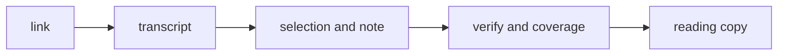

# transcript-first-video

[English](#transcript-first-video) · [中文](#中文)

[](https://github.com/HappyDrunk/transcript-first-video/actions/workflows/gate.yml)
[](LICENSE)
[](https://github.com/HappyDrunk/transcript-first-video/tags)

YouTube and X/Twitter video only, read from the transcript. The scripts fetch and check. You write the note.

The note waits until the spoken words are written down and pass a quality check. A title, a blurb, or the post beside the link is not a watch. The gate reads the transcript text. It does not listen to the audio.

## Quickstart

On install, ask for a language once, before any fetch. Save one line in `language.txt` beside the installed `SKILL.md`: `中文`, `英文`, or `中英文对照`. If that folder is not writable, keep the same line in the host project. If the file is missing or not one of those three, ask. Do not assume `中英文对照`. Do not commit `language.txt`.

```text
Install this skill: https://github.com/HappyDrunk/transcript-first-video
```

Install the whole repository directory. Do not copy only `SKILL.md` or a subset of `scripts/`; the skill depends on the scripts and reference files beside it. If the agent cannot install from a link, clone the repository and leave the folder name as it is:

```bash
git clone https://github.com/HappyDrunk/transcript-first-video.git ~/.agents/skills/transcript-first-video
python3 ~/.agents/skills/transcript-first-video/scripts/install_check.py
```

The check prints the installed commit (or the `VERSION` for a source copy) and fails with a list of missing files when the installation is incomplete.

Fetch one captioned URL.

```bash
pip install -r requirements.txt
python3 scripts/youtube_host.py "https://www.youtube.com/watch?v=jNQXAC9IVRw" --out artifacts
```

In chat, after install:

```text
Use transcript-first-video on this video, then write the note: <url>
```



## Contents

- [Note](#note)
- [Read-feel knobs](#read-feel-knobs)
- [Checks](#checks)
- [Optional YouTube screen text](#optional-youtube-screen-text)
- [Evidence](#evidence)
- [License](#license)
- [中文](#中文)


## Note

Read the full timed transcript, record what to keep or omit in `selection.md`, then write `note.md`. The note starts with `## 先记住一句话`, uses middle sections suited to the video type, and ends with `## 原文依据`. Chinese prose defaults to plain language for beginners.

The format and four synthetic examples are in [references/delivery-format.md](references/delivery-format.md).

## Read-feel knobs


Adjust these when the reader asks. Keep the [single-note format and evidence](references/delivery-format.md).

| Knob | What it changes |
| :--- | :--- |
| 语气 | How formal the sentences sound |
| 密度 | How tight or open the paragraphs are |
| 比喻 | A metaphor only when the quote already supports it |
| 类比 | An analogy only when the quote already supports it |
| 专名 | A Latin proper noun stays as the quote has it, unless you are told to gloss it |

## Checks

```bash
pip install -r requirements.txt
python3 scripts/youtube_host.py "https://www.youtube.com/watch?v=jNQXAC9IVRw" --out artifacts
# python3 scripts/x_host.py "https://x.com/USER/status/STATUS_ID" --out artifacts
python3 scripts/render_reading_note.py --task-dir artifacts/youtube_jNQXAC9IVRw --output "channel/〈发布日期〉 〈频道〉 - 〈标题〉.md"
```

The host writes the transcript and a blank scaffold. Write the selection and evidence note, then run the renderer. It runs verify and coverage and writes the reading copy once the current job is `finished`. With `ASR_BACKEND` unset, speech recognition stays off, and no captions means stop. Offline check: `bash scripts/smoke.sh`. More commands are in [scripts/README.md](scripts/README.md).

## Optional YouTube screen text

`TFV_SCREEN_MODE` defaults to `off`. Use `slides` for talks with slides or `nameplate` to read lower thirds in the first 180 seconds. Set the same mode when running the host, verifier, coverage check, and reading renderer. The transcript still determines whether the job can proceed.

```bash
export TFV_SCREEN_MODE=slides
python3 scripts/youtube_host.py "<YouTube URL>" --out artifacts --asr off --json
# After writing selection.md and note.md:
python3 scripts/render_reading_note.py --task-dir "artifacts/youtube_<ID>" --output "reading.md"
```

Slide OCR uses the full frame by default, including when slides are embedded in the video layout. `TFV_SLIDE_CROP` is an optional override using `x,y,width,height` as fractions of the source frame. OCR uses English by default. With the corresponding Tesseract language data installed, `TFV_OCR_LANG` can select another language or a combination such as `eng+chi_sim`.

`screen.txt` contains recognized lines and their source timestamps. Only `[画面]` lines can be cited. A numeric spelling must match exactly in at least two distinct image treatments. OCR uses the original size, half size, and inverted binary image, with extra passes when the image contains bright areas or saturated colors that can isolate text. `screen-frames/` holds the screenshots for the emitted lines, and `status.json` records tool versions, elapsed time including the video download, and the line numbers associated with each screenshot. Downloaded video is temporary. When screen OCR fails or times out, the host records the reason and proceeds with the transcript. See [the evidence format](references/delivery-format.md) for quoting and attribution.

Install Python and yt-dlp as above. On Debian or Ubuntu, install the OCR tools manually.

```bash
sudo apt update
sudo apt install ffmpeg tesseract-ocr tesseract-ocr-eng
```

If the VM cannot reach the apt mirror, download the official `.deb` packages and any missing dependencies for its distro release and architecture. Compare each downloaded file's SHA-256 with its `SHA256` value from the repository's signed package metadata before installing it. [Ubuntu archive verification](https://documentation.ubuntu.com/security/software-integrity/archive-verification/)

```bash
sha256sum ./package.deb
sudo dpkg -i ./package.deb
```

The scripts use the installed versions. After a Grok Bot VM rebuild, reinstall the tools and language data. The probe downloaded 1080p with yt-dlp 2026.08.19 despite a missing Deno warning. If YouTube downloads start failing, first try updating yt-dlp and installing Deno.

## Evidence

Public receipts: [evals/results/live/](evals/results/live/)

A person's read: [evals/results/spotcheck.md](evals/results/spotcheck.md)

Measured receipt on hallucinations: [evals/results/hall_j_retest_receipt.md](evals/results/hall_j_retest_receipt.md)

Mechanical held-out receipt (verify and Coverage C only; not a 9): [evals/results/held_out_mechanical_receipt.md](evals/results/held_out_mechanical_receipt.md)

How to change this repo: [CONTRIBUTING.md](CONTRIBUTING.md), [CHANGELOG.md](CHANGELOG.md)

## License

[MIT](LICENSE). Copyright (c) 2026 HappyDrunk.

## 中文

只抓 YouTube 和 Twitter/X 的视频。脚本负责抓取和核对。笔记由你来写。

笔记要等嘴里的话落成文字，并且通过质量检查。标题、简介、链接旁边的帖子，都不算看过。门槛读的是文稿，不听音频。

### 安装

安装时先问一次语言，再抓视频。在装好的 `SKILL.md` 旁边，把一行写进 `language.txt`：`中文`、`英文`，或 `中英文对照`。那个目录不能写时，把同一行留在你自己的项目里。文件没有，或不是这三样，就问。不要默认中英文对照。不要提交 `language.txt`。

```text
帮我安装这个skill：https://github.com/HappyDrunk/transcript-first-video
```

不能从链接安装时，自己克隆，文件夹名留着：

```bash
git clone https://github.com/HappyDrunk/transcript-first-video.git ~/.agents/skills/transcript-first-video
```

装好之后，在对话里：

```text
用 transcript-first-video，把这个视频看完再写笔记：<url>
```

### 怎么跑

```bash
pip install -r requirements.txt
python3 scripts/youtube_host.py "https://www.youtube.com/watch?v=jNQXAC9IVRw" --out artifacts
# python3 scripts/x_host.py "https://x.com/USER/status/STATUS_ID" --out artifacts
python3 scripts/render_reading_note.py --task-dir artifacts/youtube_jNQXAC9IVRw --output "频道/〈发布日期〉 〈频道〉 - 〈标题〉.md"
```

主机写下文稿和空白脚手架。先通读并写取舍，再写证据版。写完后运行阅读版脚本，它先执行 verify 和 coverage，两项通过且当前任务状态为 `finished` 后写入阅读版。没开 `ASR_BACKEND` 时不做语音识别，没有字幕就停。离线自检用 `bash scripts/smoke.sh`。更多命令见 [scripts/README.md](scripts/README.md)。

YouTube 画面识别默认关闭。带幻灯片的大会或讲座用 `TFV_SCREEN_MODE=slides`，只找片头三分钟内的人名条用 `TFV_SCREEN_MODE=nameplate`。抓取、验稿、覆盖检查和生成阅读版时使用相同的设置。识别失败或超时会记入 `status.json`，任务继续使用字幕。虚拟机重建后须重新安装工具和语言包。[画面识别的安装和用法](#optional-youtube-screen-text)

### 笔记

`selection.md` 按文稿顺序记下每段留或略和理由。`note.md` 从「先记住一句话」开篇，中间按视频类型组织，文末「原文依据」保留逐字引文。中文默认用初学者能懂的白话。

模板和四个示例见 [交付格式](references/delivery-format.md)。

### 读感旋钮


读者提出要求时，可以调整下面这些写法。成稿按[交付格式](references/delivery-format.md)保留结构和证据。

| 旋钮 | 改什么 |
| :--- | :--- |
| 语气 | 句子正式还是口语 |
| 密度 | 段落紧还是松 |
| 比喻 | 只用引文已经撑得住的比喻 |
| 类比 | 只用引文已经撑得住的类比 |
| 专名 | 拉丁专名按引文保留，除非明确要求改写成解释 |

### 证据

公开跑过的回执：[evals/results/live/](evals/results/live/)

人读过的样本：[evals/results/spotcheck.md](evals/results/spotcheck.md)

幻觉相关实测回执：[evals/results/hall_j_retest_receipt.md](evals/results/hall_j_retest_receipt.md)

机械抽查回执（只含核对和 Coverage C，不是 9 分）：[evals/results/held_out_mechanical_receipt.md](evals/results/held_out_mechanical_receipt.md)

怎么改仓库：[CONTRIBUTING.md](CONTRIBUTING.md)、[CHANGELOG.md](CHANGELOG.md)

### 许可

[MIT](LICENSE)。Copyright (c) 2026 HappyDrunk。
