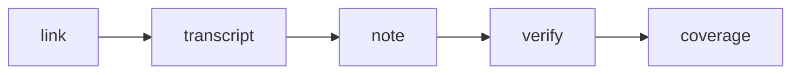

# transcript-first-video

[English](#transcript-first-video) · [中文](#中文)

[](https://github.com/HappyDrunk/transcript-first-video/actions/workflows/gate.yml)
[](LICENSE)
[](https://github.com/HappyDrunk/transcript-first-video/tags)

YouTube and X/Twitter video only, read from the transcript. The scripts fetch and check. You write the note.

The note waits until the spoken words are written down and pass a quality check. A title, a blurb, or the post beside the link is not a watch. The gate reads the transcript text. It does not listen to the audio.

## Quickstart

On install, ask for a language once, before any fetch. Save one line in `language.txt` beside the installed `SKILL.md`: `中文`, `英文`, or `中英文对照`. If that folder is not writable, keep the same line in the host project. If the file is missing or not one of those three, ask. Do not assume `中英文对照`. Do not commit `language.txt`.

```text
Install this skill: https://github.com/HappyDrunk/transcript-first-video
```

If the agent cannot install from a link, clone the folder and leave the name as it is:

```bash
git clone https://github.com/HappyDrunk/transcript-first-video.git ~/.agents/skills/transcript-first-video
```

Fetch one captioned URL.

```bash
pip install -r requirements.txt
python3 scripts/youtube_host.py "https://www.youtube.com/watch?v=jNQXAC9IVRw" --out artifacts
```

In chat, after install:

```text
Use transcript-first-video on this video, then write the note: <url>
```



## Contents

- [Note](#note)
- [Read-feel knobs](#read-feel-knobs)
- [Checks](#checks)
- [Evidence](#evidence)
- [License](#license)
- [中文](#中文)

## Note

A finished note looks like this:

````markdown
## 先记住一句话
*(One sentence to remember)*

## 问题与做法
*(Problem and approach)*

## 完整怎么做
*(How to do it end to end)*

## 翻车或别用
*(When it breaks or when not to use it)*

## 今天立刻动手一步
*(One step you can take today)*
````

Chinese delivery defaults to beginner-clear prose: plain words for why, what, and the benefit; no jargon piled into titles or the body; proper nouns from the talk may stay.

Example: [references/note-examples.md](references/note-examples.md).

## Read-feel knobs

The opening heading, the four sections, R01–R17, and Coverage C stay fixed. These knobs change read-feel only. They are not an install wizard. Set one only when someone asks. Changing a knob leaves R01–R17 and Coverage C in force. Delivery wording stays in the delivered body and does not rewrite `note.md`.

| Knob | What it changes |
| :--- | :--- |
| 语气 | How formal the sentences sound |
| 密度 | How tight or open the paragraphs are |
| 比喻 | A metaphor only when the quote already supports it |
| 类比 | An analogy only when the quote already supports it |
| 专名 | A Latin proper noun stays as the quote has it, unless you are told to gloss it |

## Checks

```bash
pip install -r requirements.txt
python3 scripts/youtube_host.py "https://www.youtube.com/watch?v=jNQXAC9IVRw" --out artifacts
# python3 scripts/x_host.py "https://x.com/USER/status/STATUS_ID" --out artifacts
python3 scripts/verify_note.py --job artifacts/youtube_jNQXAC9IVRw
python3 scripts/coverage_check.py --job artifacts/youtube_jNQXAC9IVRw
```

The host only writes the transcript and a blank scaffold; you write the note. Then run `verify_note.py`, then `coverage_check.py`, and deliver only after both pass. With `ASR_BACKEND` unset, speech recognition stays off, and no captions means stop. Offline check: `bash scripts/smoke.sh`. More commands: [scripts/README.md](scripts/README.md).

## Evidence

Public receipts: [evals/results/live/](evals/results/live/)

A person's read: [evals/results/spotcheck.md](evals/results/spotcheck.md)

Measured receipt on hallucinations: [evals/results/hall_j_retest_receipt.md](evals/results/hall_j_retest_receipt.md)

How to change this repo: [CONTRIBUTING.md](CONTRIBUTING.md), [CHANGELOG.md](CHANGELOG.md)

## License

[MIT](LICENSE). Copyright (c) 2026 HappyDrunk.

## 中文

只抓 YouTube 和 Twitter/X 的视频。脚本负责抓取和核对。笔记由你来写。

笔记要等嘴里的话落成文字，并且通过质量检查。标题、简介、链接旁边的帖子，都不算看过。门槛读的是文稿，不听音频。

### 安装

安装时先问一次语言，再抓视频。在装好的 `SKILL.md` 旁边，把一行写进 `language.txt`：`中文`、`英文`，或 `中英文对照`。那个目录不能写时，把同一行留在你自己的项目里。文件没有，或不是这三样，就问。不要默认中英文对照。不要提交 `language.txt`。

```text
帮我安装这个skill：https://github.com/HappyDrunk/transcript-first-video
```

不能从链接安装时，自己克隆，文件夹名留着：

```bash
git clone https://github.com/HappyDrunk/transcript-first-video.git ~/.agents/skills/transcript-first-video
```

装好之后，在对话里：

```text
用 transcript-first-video，把这个视频看完再写笔记：<url>
```

### 怎么跑

```bash
pip install -r requirements.txt
python3 scripts/youtube_host.py "https://www.youtube.com/watch?v=jNQXAC9IVRw" --out artifacts
# python3 scripts/x_host.py "https://x.com/USER/status/STATUS_ID" --out artifacts
python3 scripts/verify_note.py --job artifacts/youtube_jNQXAC9IVRw
python3 scripts/coverage_check.py --job artifacts/youtube_jNQXAC9IVRw
```

主机只写下文稿和空白脚手架；笔记由你来写。写完后先跑 `verify_note.py`，再跑 `coverage_check.py`，两道都过再交出去。没开 `ASR_BACKEND` 时不做语音识别，没有字幕就停。离线自检：`bash scripts/smoke.sh`。更多命令见 [scripts/README.md](scripts/README.md)。

### 笔记

写完的笔记长这样：

````markdown
## 先记住一句话

## 问题与做法

## 完整怎么做

## 翻车或别用

## 今天立刻动手一步
````

中文默认小白能懂：白话讲清为什么、是什么、好处；标题和正文不堆术语；片子里出现的专名可以留。

例子：[references/note-examples.md](references/note-examples.md)

### 读感旋钮

开头标题、四节、R01–R17、Coverage C 保持不动。下面只改读感。安装时不问。有人开口要改，才动。改旋钮之后，R01–R17 和 Coverage C 仍然有效。交付时的措辞留在交付正文里，不回写 `note.md`。

| 旋钮 | 改什么 |
| :--- | :--- |
| 语气 | 句子正式还是口语 |
| 密度 | 段落紧还是松 |
| 比喻 | 只用引文已经撑得住的比喻 |
| 类比 | 只用引文已经撑得住的类比 |
| 专名 | 拉丁专名按引文保留，除非明确要求改写成解释 |

### 证据

公开跑过的回执：[evals/results/live/](evals/results/live/)

人读过的样本：[evals/results/spotcheck.md](evals/results/spotcheck.md)

幻觉相关实测回执：[evals/results/hall_j_retest_receipt.md](evals/results/hall_j_retest_receipt.md)

怎么改仓库：[CONTRIBUTING.md](CONTRIBUTING.md)、[CHANGELOG.md](CHANGELOG.md)

### 许可

[MIT](LICENSE)。Copyright (c) 2026 HappyDrunk。
